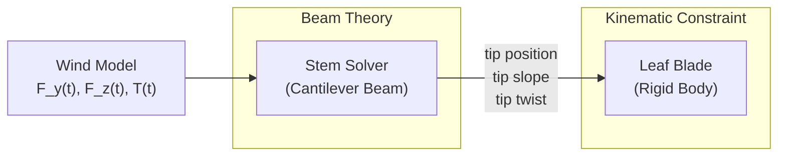

# Physics Report: Leaf Flutter Simulation
### Modeling a Leaf on a Stem using 3D Beam Theory
*Based on Lectures from the Mechanics of Solids Course (Chapters 6–10)*

---

## 1. Introduction

This report describes the physics behind a computational simulation of a leaf fluttering in the wind. The leaf stem (petiole) is modeled as a **3D cantilever beam** undergoing coupled **bending** and **torsion**, while the leaf blade is treated as a **rigid body** attached at the beam's tip. Wind is approximated as a time-varying force applied at the tip, avoiding the need for full fluid–structure interaction modeling.

The entire mathematical framework is derived from the course lectures:

| Chapter | Topic | Role in This Project |
|---------|-------|---------------------|
| Ch. 6 | Stress–Strain Relations | Constitutive law: $E$, $\nu$, $G = E/2(1+\nu)$ |
| Ch. 7 | Torsion of Cylinders | Torque–twist relation: $T = GJ\,\Omega/L$ |
| Ch. 8 | Bending of Beams | Bending stress: $\sigma = -M_z y / I_{zz}$ |
| Ch. 9 | Theory of Beams (EBT) | Governing ODE: $EI\,d^2y/dX^2 = M(X)$ |
| Ch. 10 | Energy Methods | Strain energy & Castigliano's theorem |

---

## 2. Constitutive Relations (Chapter 6)

### 2.1 Assumptions
The following assumptions from Ch. 6 underpin the entire model:

1. **Infinitesimal strains** — displacements and displacement gradients are small (linear strain–displacement)
2. **Linear elasticity (Hooke's Law)** — stress depends linearly on strain
3. **Material isotropy** — elastic properties are invariant under rotation, reducing 21 stiffness constants to just 2

### 2.2 Generalized Hooke's Law
For an isotropic material, the constitutive relation is (Ch. 6, Eq. 36):

$$\sigma_{ij} = \lambda\,\text{tr}(\boldsymbol{\epsilon})\,\delta_{ij} + 2\mu\,\epsilon_{ij}$$

In engineering notation, the normal strains are (Ch. 6, Eqs. 42–44):

$$\epsilon_{11} = \frac{1}{E}\left[\sigma_{11} - \nu(\sigma_{22} + \sigma_{33})\right]$$

And shear strains are (Ch. 6, Eqs. 45–47):

$$\gamma_{12} = \frac{\tau_{12}}{G}$$

### 2.3 The Three Elastic Constants
The shear modulus is not independent but related to Young's modulus and Poisson's ratio by (Ch. 6, Eq. 48):

$$\boxed{G = \frac{E}{2(1+\nu)}}$$

> [!IMPORTANT]
> This single relation connects the bending world ($E$, $I$) to the torsion world ($G$, $J$). In the simulation, the user sets $E$ and $\nu$, and $G$ is computed automatically.

For the stem, we use default values representative of plant tissue:
- $E = 2.0$ GPa (cellulose-based plant stem)
- $\nu = 0.35$
- $\Rightarrow G = 2.0 / (2 \times 1.35) \approx 0.74$ GPa

---

## 3. Pure Bending Theory (Chapter 8)

### 3.1 Geometry of Deformation
When a beam is subjected to pure bending, all longitudinal fibers deform into arcs of concentric circles. A fiber at distance $y$ from the neutral axis experiences strain (Ch. 8, Eq. 3):

$$\epsilon_{xx} = -\frac{y}{R}$$

where $R$ is the radius of curvature of the neutral line.

### 3.2 Bending Stress
Using $\sigma_{yy} = \sigma_{zz} = 0$ (free lateral surfaces) and Hooke's law (Ch. 8, Eq. 5):

$$\sigma_{xx} = E\,\epsilon_{xx} = -\frac{Ey}{R}$$

### 3.3 Neutral Axis Location
The neutral axis passes through the centroid of the cross-section, proven by the condition of zero net axial force (Ch. 8, Eq. 6):

$$\iint_{\Omega_0} \sigma_{xx}\,dA = 0 \implies \bar{Y} = 0$$

### 3.4 Moment–Curvature Relation
Integrating the moment of the stress distribution over the cross-section yields (Ch. 8, Eqs. 8–10):

$$\boxed{M_z = EI_{zz}\,\kappa}$$

where:
- $I_{zz} = \iint y^2\,dA$ is the **second moment of area** about the neutral axis
- $\kappa = 1/R$ is the bending curvature
- $EI_{zz}$ is the **flexural rigidity** (bending stiffness)

### 3.5 The Bending Stress Formula
Combining the above (Ch. 8, Eq. 11):

$$\boxed{\sigma_{xx} = -\frac{M_z\,y}{I_{zz}}}$$

Maximum bending stress occurs at the outermost fiber ($y = d/2$ for a circular section):

$$\sigma_{\max} = \frac{M_{\max}\,(d/2)}{I}$$

### 3.6 Second Moment of Area for a Circular Cross-Section
For a solid circular stem of diameter $d$:

$$I = \frac{\pi d^4}{64}$$

---

## 4. Euler-Bernoulli Beam Theory (Chapter 9)

### 4.1 Assumptions
The Euler-Bernoulli beam theory (EBT) makes three key assumptions (Ch. 9, §9.2):

1. **Cross-section normal aligned with centerline tangent** — no transverse shear deformation
2. **Axial displacement negligible** — deformed coordinate $x \approx X$ (Eq. 4)
3. **Small slope** — $|dy/dX| \ll 1$ (Eq. 6)

These assumptions linearize the curvature to (Ch. 9, Eq. 7):

$$\kappa(X) \approx \frac{d^2y}{dX^2}$$

### 4.2 The Governing Equation
Substituting into the moment-curvature relation gives the governing ODE of EBT (Ch. 9, Eq. 8):

$$\boxed{EI\,\frac{d^2y}{dX^2} = M(X)}$$

### 4.3 Cantilever Beam with Tip Point Load (Example 1)

This is **exactly our model**: a cantilever clamped at $X=0$ with a transverse load $P$ at $X=L$.

**Bending Moment Profile** (Ch. 9, Eq. 9):
$$M(X) = P(L - X)$$

**Boundary Conditions** at the clamped end (Ch. 9, Eqs. 11–12):
$$y(0) = 0, \quad \frac{dy}{dX}(0) = 0$$

**Solving the ODE** by double integration (Ch. 9, Eqs. 13–15):

$$\frac{dy}{dX} = \frac{P}{EI}\left(LX - \frac{X^2}{2}\right)$$

$$\boxed{y(X) = \frac{P}{6EI}\,X^2\,(3L - X)}$$

**Tip deflection** at $X = L$ (Ch. 9, Eq. 16):

$$\boxed{y_{\text{tip}} = \frac{PL^3}{3EI}}$$

**Tip slope**:
$$\theta_{\text{tip}} = \frac{PL^2}{2EI}$$

> [!NOTE]
> In the simulation, the beam is loaded in **two transverse directions** ($Y$ and $Z$) simultaneously by the wind force components $F_y(t)$ and $F_z(t)$. Each is solved independently using the same formula since the equations are linear and decouple by direction.

### 4.4 Validity Check
EBT is valid when the aspect ratio $L/d$ is sufficiently large. For our stem:
- $L = 80$ mm, $d = 3$ mm → $L/d \approx 27 \gg 10$ ✓

The relative error of EBT compared to Timoshenko beam theory (Ch. 9, Eq. 49) is negligible at this slenderness ratio.

---

## 5. Torsion of the Stem (Chapter 7)

### 5.1 Kinematic Assumptions
When a cylindrical shaft is twisted (Ch. 7, §7.5):

1. **Axisymmetry** — no displacement depends on circumferential coordinate $\theta$
2. **Axial homogeneity** — radial displacement $u_r$ is independent of $z$
3. **No warping** — planar cross-sections remain planar
4. **Small angle of twist** — circumferential displacement is (Ch. 7, Eq. 59):

$$u_\theta = \alpha(z)\,r$$

### 5.2 Strain and Stress Fields
The only non-zero shear strain from torsion is (Ch. 7, Eq. 61):

$$\gamma_{\theta z} = \alpha'(z)\,r$$

From equilibrium ($G\alpha''r = 0$), the rate of twist $\alpha'$ must be constant along the length (Ch. 7, Eq. 75). Therefore:

$$\alpha'(z) = \frac{\Omega}{L}, \quad \alpha(z) = \frac{\Omega}{L}\,z$$

The shear stress distribution is linear in $r$ (Ch. 7, Eq. 105):

$$\tau_{\theta z} = G\,\frac{\Omega}{L}\,r$$

### 5.3 Torque–Twist Relation
Integrating the moment of shear stress over the cross-section (Ch. 7, Eqs. 104–107):

$$T = G\,\frac{\Omega}{L}\,\iint r^2\,dA = GJ\,\frac{\Omega}{L}$$

$$\boxed{\Omega = \frac{TL}{GJ}}$$

where $J = \iint r^2\,dA$ is the **polar moment of area**. For a solid circular section:

$$J = \frac{\pi d^4}{32}$$

> [!NOTE]
> Comparing: $J = 2I$ for a solid circle, since $J = \pi d^4/32$ and $I = \pi d^4/64$.

### 5.4 Maximum Torsional Shear Stress
$$\tau_{\max} = \frac{T\,(d/2)}{J}$$

### 5.5 How Torsion Enters the Leaf Model
Wind exerts an asymmetric aerodynamic force on the elliptical leaf blade. Because the center of pressure generally does not coincide with the stem axis, the wind force produces a **torque** $T$ about the stem's longitudinal axis. This torque twists the stem, causing the leaf blade to rotate. The twist angle at the tip is:

$$\phi_{\text{tip}} = \frac{T \cdot L}{GJ}$$

---

## 6. Energy Methods & Coupled Loading (Chapter 10)

### 6.1 Strain Energy in Bending and Torsion
Under general loading, the total strain energy stored in a beam is (Ch. 10, Eq. 53):

$$U = \int_0^L \left[\frac{M_z(x)^2}{2EI_{zz}} + \frac{T(x)^2}{2GJ}\right] dx$$

(We omit axial stretching and transverse shear per the project brief.)

For our cantilever with constant tip loads $F$ and $T$:

- **Bending energy**: $U_{\text{bend}} = \frac{F^2 L^3}{6EI}$
- **Torsional energy**: $U_{\text{tors}} = \frac{T^2 L}{2GJ}$

### 6.2 Castigliano's Theorem
From Ch. 10 (Eq. 36), the displacement $\delta_k$ corresponding to any generalized force $F_k$ is:

$$\delta_k = \frac{\partial U}{\partial F_k}$$

This provides a powerful verification tool. For the tip deflection:

$$y_{\text{tip}} = \frac{\partial U_{\text{bend}}}{\partial F} = \frac{\partial}{\partial F}\left(\frac{F^2 L^3}{6EI}\right) = \frac{FL^3}{3EI} \quad \checkmark$$

---

## 7. Wind Load Approximation

### 7.1 The Fluid–Structure Interaction Problem
In reality, the wind flow around a leaf is a complex fluid–structure interaction (FSI) problem. The aerodynamic drag force on the leaf depends on the leaf's instantaneous shape and orientation, which in turn depends on the stem's deflection, creating a coupled problem. Following the project brief, we **avoid modeling the fluid** and instead approximate the wind as a prescribed forcing function.

### 7.2 Wind Force Model
The wind force is decomposed into three components applied at the stem tip:

1. **Transverse Force $F_y(t)$** — primary bending in the wind direction:
$$F_y(t) = F_0\left[\sin(\omega t) + 0.3\sin(1.73\omega t + \pi/4) + \eta\,n_1(t)\right]$$

2. **Transverse Force $F_z(t)$** — lateral swaying:
$$F_z(t) = F_0\left[0.7\sin(0.81\omega t + \pi/3) + 0.2\sin(2.17\omega t) + \eta\,n_2(t)\right]$$

3. **Torque $T(t)$** — twist due to asymmetric pressure on the leaf:
$$T(t) = \frac{F_0 b}{3}\left[\sin(1.31\omega t + \pi/6) + 0.25\,n_3(t)\right]$$

where:
- $F_0$ = base wind strength (N)
- $\omega = 2\pi f$ = angular frequency of dominant wind oscillation
- $\eta$ = gust intensity (turbulence parameter, $0 \leq \eta \leq 1$)
- $n_i(t)$ = pseudo-random turbulence functions (sum of incommensurate sinusoids)
- $b$ = leaf semi-axis, giving the torque arm

> [!TIP]
> The use of **incommensurate frequencies** (ratios like 1.73, 0.81, 2.17, 1.31 — all irrational multiples of the base frequency) ensures the forcing is quasi-periodic and never exactly repeats, closely mimicking the chaotic nature of real wind turbulence without requiring a stochastic random number generator.

---

## 8. The Complete Model: Putting It Together

### 8.1 Architecture

### 8.2 Step-by-Step Solution at Each Time Step

**Given** material parameters ($E$, $\nu$, $\rho$), geometry ($L$, $d$, $a$, $b$), and wind parameters ($F_0$, $f$, $\eta$):

1. **Compute derived properties:**
   - $G = E / [2(1+\nu)]$ (Ch. 6, Eq. 48)
   - $I = \pi d^4 / 64$ (Ch. 8)
   - $J = \pi d^4 / 32$ (Ch. 7)
   - $EI$ = bending stiffness, $GJ$ = torsional stiffness

2. **Evaluate wind forces** at current time $t$:
   - $F_y(t)$, $F_z(t)$, $T(t)$

3. **Solve bending in Y-direction** (Ch. 9, Eq. 15):
   $$v_y(X) = \frac{F_y}{6EI}\,X^2(3L - X)$$
   $$\theta_y(X) = \frac{F_y}{2EI}\,X(2L - X)$$

4. **Solve bending in Z-direction** (same equation, independent):
   $$v_z(X) = \frac{F_z}{6EI}\,X^2(3L - X)$$
   $$\theta_z(X) = \frac{F_z}{2EI}\,X(2L - X)$$

5. **Solve torsion** (Ch. 7, Eq. 107):
   $$\phi(X) = \frac{TX}{GJ}$$

6. **Extract tip state** at $X = L$:
   - Position: $(L,\; v_y(L),\; v_z(L))$
   - Slopes: $\theta_y(L)$, $\theta_z(L)$
   - Twist: $\phi(L)$

7. **Attach leaf via kinematic constraint:**
   - Translate leaf to tip position
   - Rotate leaf by Euler angles $(\phi,\, -\theta_z,\, \theta_y)$

### 8.3 What We Neglect (and Why It's OK)

| Effect | Neglected? | Justification |
|--------|-----------|---------------|
| Axial stretching | Yes | Per project brief: "quite possible you can get reasonable results even without axial stretching" |
| Transverse shear (Timoshenko) | Yes | $L/d \approx 27 \gg 10$, so EBT error $< 1\%$ (Ch. 9, Eq. 49) |
| Large deformations | Yes | Tip deflection $\sim 1\text{–}3$ mm $\ll L = 80$ mm, so $|dy/dX| \ll 1$ (Ch. 9, Eq. 6) |
| Fluid–structure coupling | Yes | Per project brief: "avoid modelling the fluid" |
| Leaf blade flexibility | Yes | Leaf treated as rigid body; stem motion dominates |

---

## 9. Dynamic Analysis & Natural Frequencies

### 9.1 Free Vibration of a Cantilever Beam
From the dynamic Euler-Bernoulli equation (combining Ch. 6, Eq. 5 with Ch. 9, Eq. 8):

$$EI\,\frac{\partial^4 v}{\partial X^4} + \rho A\,\frac{\partial^2 v}{\partial t^2} = 0$$

The fundamental natural frequency of a cantilever beam is:

$$\boxed{\omega_1 = (\beta_1 L)^2 \sqrt{\frac{EI}{\rho A L^4}}, \quad \beta_1 L = 1.8751}$$

$$f_1 = \frac{\omega_1}{2\pi} = \frac{3.516}{2\pi}\sqrt{\frac{EI}{\rho A L^4}}$$

### 9.2 Torsional Natural Frequency
For a cantilever in torsion:

$$f_{t1} = \frac{1}{4L}\sqrt{\frac{G}{\rho}}$$

### 9.3 Resonance Criterion
When the wind forcing frequency $f$ approaches the natural bending frequency $f_1$, the beam response amplifies dramatically (**resonance**). The simulation monitors the ratio:

$$\text{Frequency ratio} = \frac{f_{\text{wind}}}{f_1}$$

> [!CAUTION]
> When $0.8 < f_{\text{wind}}/f_1 < 1.2$, the system is near resonance and the linear quasi-static analysis breaks down. The simulation displays a **resonance warning** in this regime.

---

## 10. Verification & Cross-Checks

### 10.1 Analytical Tip Deflection
With default parameters ($E = 2$ GPa, $d = 3$ mm, $L = 80$ mm, $F_0 = 0.03$ N):

$$I = \frac{\pi (0.003)^4}{64} = 3.976 \times 10^{-12}\;\text{m}^4$$

$$y_{\text{tip}} = \frac{F_0 L^3}{3EI} = \frac{0.03 \times 0.08^3}{3 \times 2 \times 10^9 \times 3.976 \times 10^{-12}} = \frac{1.536 \times 10^{-5}}{2.386 \times 10^{-2}} \approx 0.64\;\text{mm}$$

### 10.2 Natural Frequency
$$A = \frac{\pi (0.003)^2}{4} = 7.069 \times 10^{-6}\;\text{m}^2$$

$$f_1 = \frac{3.516}{2\pi}\sqrt{\frac{2 \times 10^9 \times 3.976 \times 10^{-12}}{1100 \times 7.069 \times 10^{-6} \times 0.08^4}} \approx 88.4\;\text{Hz}$$

This matches the simulation output of **88.4 Hz** ✓

### 10.3 Boundary Condition Check
At $X = 0$ (clamped end):
- $v(0) = 0$ ✓ (zero deflection)
- $dv/dX(0) = 0$ ✓ (zero slope)

At $X = L$ (free end):
- $M(L) = F(L-L) = 0$ ✓ (zero moment at free tip)
- $V(L) = F$ ✓ (shear equals applied load)

---

## 11. References

All equations and theory in this report are sourced directly from the following course lectures:

1. **Chapter 6**: *Stress–Strain Relation* — Generalized Hooke's law, elastic moduli interrelations ($G = E/2(1+\nu)$, Eq. 48)
2. **Chapter 7**: *Solving Axisymmetric Problems: Extension, Torsion and Inflation* — Torsion kinematic field (Eq. 59), shear stress distribution (Eq. 105), torque–twist relation $T = GJ\,\Omega/L$ (Eq. 107)
3. **Chapter 8**: *Bending of Beams* — Pure bending strain (Eq. 3), bending stress formula $\sigma = -My/I$ (Eq. 11), moment–curvature relation (Eq. 10)
4. **Chapter 9**: *Theory of Beams* — Euler-Bernoulli governing equation $EI\,d^2y/dX^2 = M(X)$ (Eq. 8), cantilever tip deflection $PL^3/3EI$ (Eq. 16), EBT validity criterion (Eq. 49)
5. **Chapter 10**: *Energy Methods* — Bending strain energy $M^2/2EI$ (Eq. 46), torsional strain energy $T^2/2GJ$ (Eq. 49), Castigliano's theorem (Eq. 36)
